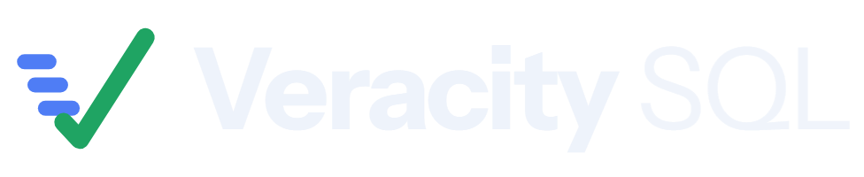
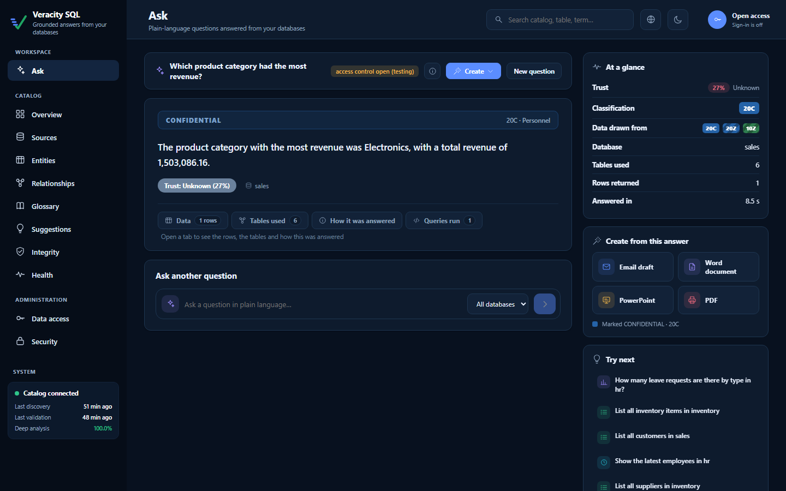
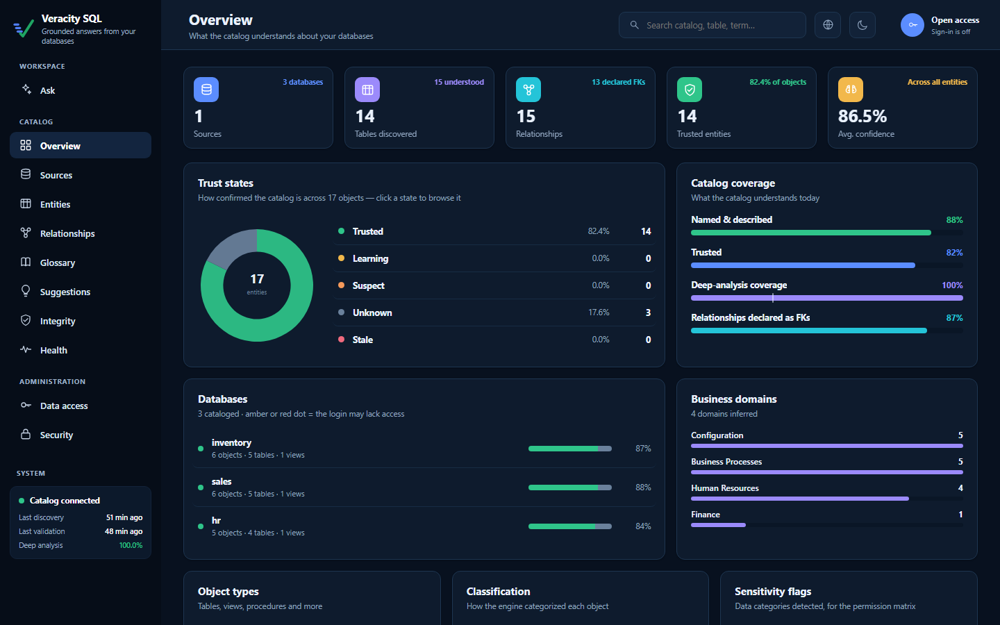
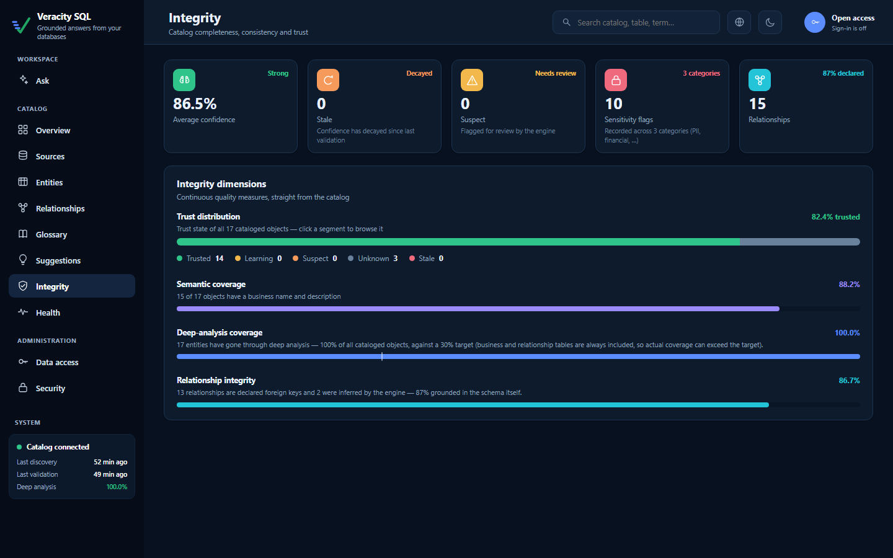
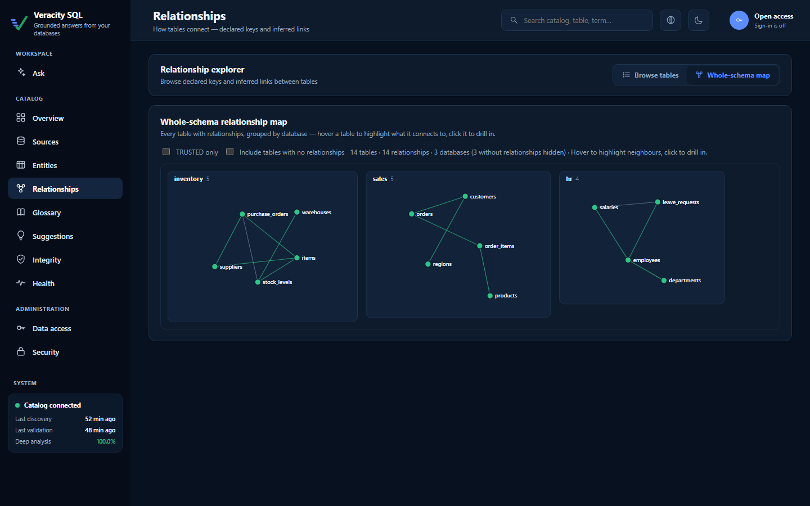
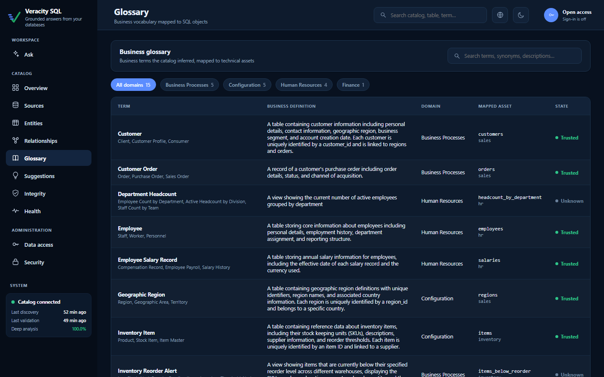
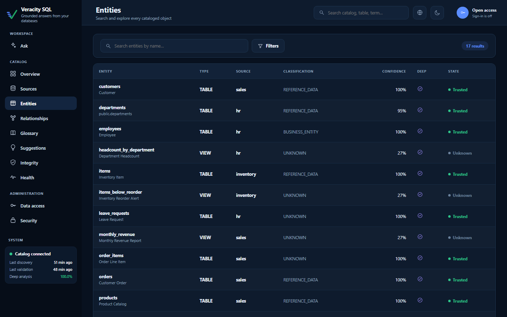
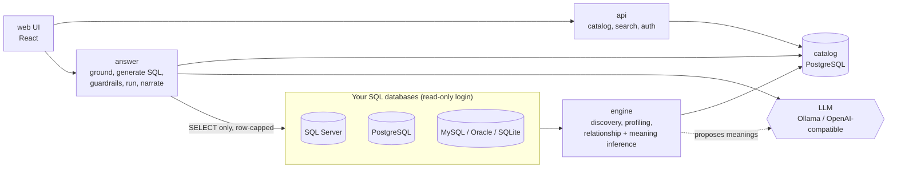

<h1 align="center">
  <picture>
    <source media="(prefers-color-scheme: dark)" srcset="docs/images/wordmark-dark.png">
    
  </picture>
</h1>

<p align="center"><b>Ask your SQL databases in plain language and get answers built from real rows, each with a trust score.</b></p>

<p align="center">
  <a href="LICENSE"></a>
  
  
  
  
  
</p>

<p align="center"></p>

**Veracity SQL** is an open-source, self-hosted **RAG engine for relational databases**. It builds and
maintains an AI data catalog of your SQL Server, PostgreSQL, MySQL/MariaDB, Oracle or SQLite
databases. That catalog grounds natural-language questions (text-to-SQL), and every generated
query is read-only and guardrailed. The answer is written from the rows that came back, with a
trust score for the tables it used. It runs on your own infrastructure with a local LLM (Ollama)
or any OpenAI-compatible endpoint.

## Quick start

You need Docker. Then:

```bash
git clone https://github.com/soimthe1/veracity-sql-rag.git
cd veracity-sql-rag
docker compose -f docker-compose.quickstart.yaml up -d --build
```

Open **http://localhost:8180**. The quick start brings its own Postgres and three demo databases
(`sales`, `hr`, `inventory`, all fictional data). Sign-in is off, and secrets are generated on
first start.

To ask questions you need an LLM. By default it uses [Ollama](https://ollama.com) on your
machine with `qwen2.5-coder:7b`. With no Ollama installed, run it in the stack instead:

```bash
docker compose -f docker-compose.quickstart.yaml --profile ollama up -d
docker compose -f docker-compose.quickstart.yaml exec ollama ollama pull qwen2.5-coder:7b
```

Then set `base_url: http://ollama:11434` in `docker/quickstart/local/config.yaml` and restart.

**First steps:** wait about two minutes for the first discovery and validation cycles. Then open
**Ask** and try *"Which product category had the most revenue?"* or *"Which items are below their
reorder level?"*. Look at what the catalog learned in **Entities** and **Glossary**, and at how
the tables connect in **Relationships → Whole-schema map**. Trust builds up over validation
cycles. Views have no keys to check, so they stay `UNKNOWN` until someone confirms them.

## What it does

| | |
|---|---|
| **Catalogs itself.** Discovers databases, tables, views, columns, keys and routines on a schedule. Infers relationships the schema doesn't declare (value-overlap tests) and business meaning (LLM, checked against evidence). |  |
| **Scores trust.** Every table and relationship moves through states such as `DISCOVERED`, `LEARNING`, `TRUSTED`, `SUSPECT` and `STALE`, based on evidence, not on what the model claims. |  |
| **Answers questions.** Grounds the question in the catalog, generates SQL for the right dialect, validates it, runs it read-only, and writes the answer from the rows. Answers export to Word or PowerPoint. |  |
| **Maps the data.** Search with typo tolerance, explore entities and an interactive relationship graph, and keep a business glossary. |  |
| **Explains your data.** A business glossary inferred from the schema and data, mapped to the tables behind each term. |  |
| **Controls access.** Optional sign-in (local accounts or LDAP/AD). Data access is set per table and per column through (level, category) cells, and every question is audited. |  |

English and Arabic UI, light and dark themes.

## How it works



1. **engine** sweeps each source on a schedule. It skips anything whose fingerprint hasn't changed,
   profiles a bounded sample, tests candidate joins, and asks the LLM what tables mean. Evidence
   decides confidence.
2. **answer** matches a question to catalog tables and columns, and gives the LLM only that slice.
   It checks the generated SQL (single `SELECT`, grounded tables only, permitted columns only, row
   cap added) and runs it with a read-only login. If nothing comes back it retries once with a
   looser query, then tries the next likely database, and narrates the result.
3. **api** serves the catalog, search and accounts. **web** is the UI.

## What sets it apart

| | Text-to-SQL libraries (e.g. Vanna, LangChain SQL agent) | Data catalogs (e.g. DataHub, OpenMetadata) | BI chat (e.g. Metabase, Superset AI features) | **Veracity SQL** |
|---|---|---|---|---|
| Builds the schema context itself | You train or supply it | Yes, from ingestion | From BI models you define | Yes, discovers and keeps it current |
| Infers undeclared relationships | No | Lineage, not join inference | No | Yes, by value-overlap tests |
| Confidence per table/relationship | No | Manual certification | No | Evidence-based trust states |
| Answers from executed rows | Returns SQL / rows | No | Yes | Yes, with trust score |
| Generated SQL guardrails | Up to you | n/a | Within BI permissions | Layered checks + read-only login |
| Column-level access for AI answers | Up to you | Policies, not enforced on AI | BI permissions | (level, category) cells, enforced in SQL checks |
| Self-hosted with a local LLM | Yes | Yes | Yes | Yes |

These tools are excellent at what they focus on. Veracity SQL is narrower: a self-maintaining
catalog whose whole job is making AI answers over SQL databases grounded, bounded and auditable.

## Engineering highlights

- **Process isolation.** engine, api and answer are separate services, so a slow source or LLM never stalls the API.
- **Defence in depth for AI-generated SQL** ([answer/guardrails.py](answer/guardrails.py)). Single statement, `SELECT`/`WITH` only, keyword deny-list, grounded-table whitelist, column-level access check, dialect-correct row cap. Underneath all of that sits the read-only login.
- **Evidence over model output.** The LLM proposes, the evidence decides. Its claims never set confidence.
- **Multi-dialect by design.** SQL Server through native ODBC, and every SQLAlchemy dialect through one generic connector. The prompts and row caps follow each source's dialect.
- **Strict configuration** ([shared/config.py](shared/config.py)). Unknown keys and literal secrets stop startup. Secrets only come from the environment, and private settings live in a git-ignored overlay.
- **Security posture.** scrypt password hashing, signed session tokens, default-deny data access, admin ≠ clearance, and a per-question audit.
- **Release hygiene.** [scripts/release_check.py](scripts/release_check.py) and a pre-push hook block private data. Images never contain secrets.
- **Tests.** Unit and API tests run with `pytest` (see [Development](#development)).

Details: [UNDER_THE_HOOD.md](UNDER_THE_HOOD.md) and [DECISIONS.md](DECISIONS.md).

## Connect your own databases

Add a source in `config/local/config.yaml` (git-ignored) and its password in `.env`:

```yaml
catalog:
  sources:
    - name: sales
      type: postgresql          # mssql | postgresql | mysql | mariadb | oracle | sqlite | any SQLAlchemy dialect (url:)
      host: db.example.internal
      user: catalog_reader      # give it read-only rights
      password: "${SRC_SALES_PASSWORD}"
```

Snowflake, BigQuery, DuckDB, ClickHouse and other SQL engines with a SQLAlchemy dialect should
work through `url:`. They are untested; reports are welcome.

## Configuration

| File | Holds |
|---|---|
| `config/config.yaml` | Every setting (sources, LLM profile, schedules, thresholds, sign-in), with comments |
| `config/config.prod.yaml` | Production values, merged on top when `APP_ENV=prod` |
| `config/local/` | Your private overlay (git-ignored), merged last |
| `config/levels.yaml` | Access levels and categories |
| `.env` | Secrets only (from `.env.example`) |
| `branding/` | Name, tagline and logo (`brand.local/` overrides `brand.example/`) |

**Sign-in** (`catalog.auth.mode`): `none` (default for local use: every visitor is an admin, so
never expose it), `local` (accounts in the app; the first visit creates the administrator), or
`ldap` (fill in `catalog.auth.ldap`).

## Security

- Give each source a **read-only** login. The guardrails are an early, audited check; the login is the boundary.
- Use `mode: local` or `ldap` anywhere other than your own machine. `config.prod.yaml` enforces it.
- Put the services behind HTTPS. The production compose file binds to `127.0.0.1` for a reverse proxy.
- Other applications can call the answer service with a service key: see [docs/integration.md](docs/integration.md).

## Development

```powershell
.\scripts\dev.ps1 setup      # .venv (Python 3.11), Python + web packages, .env from .env.example
.\scripts\dev.ps1 start      # engine, api (:8100), answer (:8200), web (:5180)
.\scripts\dev.ps1 test       # pytest
```

On macOS/Linux, follow the same steps by hand: `python -m venv .venv`,
`pip install -r requirements.txt -r requirements-dev-test.txt`, `npm ci` in `web/`, then run
`python -m engine.main`, `uvicorn api.main:app --port 8100`,
`uvicorn answer.main:app --port 8200` and `npm run dev`.

| Command | Does |
|---|---|
| `python -m pytest -q` | Unit and API tests |
| `python scripts/release_check.py` | Scan for private data before publishing |
| `python scripts/screenshots.py` | Retake the README screenshots from the quick start |

## Deployment

`docker-compose.yaml` builds and runs the four services against your own Postgres.
`docker-compose.prod.yaml` runs prebuilt images (from `.\scripts\dev.ps1 build`) with
`APP_ENV=prod`, ports bound to localhost behind your HTTPS proxy. The services apply database
migrations when they start.

## License

[Apache-2.0](LICENSE). See [NOTICE](NOTICE).
